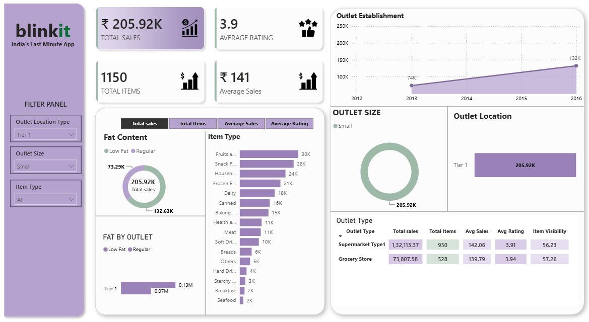
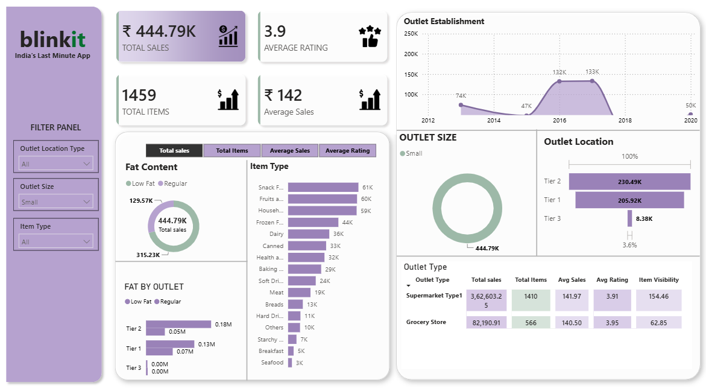

# 🛒 Blinkit Sales Analytics Dashboard


An interactive **Blinkit Grocery Sales & Outlet Performance Dashboard** developed using Microsoft Power BI.

---

## 📌 Overview

This project analyses grocery sales data to understand sales performance across product categories, outlet sizes, and location tiers.

The dashboard provides a consolidated view of key performance indicators (KPIs), interactive visualisations, and filtering capabilities to support data-driven analysis.

## 🚀 Key Features

- 📊 **Overall Performance Metrics:** Total Sales, Average Sales, Total Items and Average Rating.
- 🎛️ **Dynamic Filtering:** Filter by Outlet Location Type, Outlet Size and Item Type.
- 🛍️ **Item Category Analysis:** Compare sales across different grocery categories.
- 🏬 **Outlet Size Analysis:** Understand sales distribution across outlet sizes.
- 📍 **Location Tier Analysis:** Compare Tier 1, Tier 2 and Tier 3 performance.
- 📅 **Establishment-Year Analysis:** Explore sales by outlet establishment year.
- 🧹 **Data Preparation:** Power Query transformations and category standardisation.

## 📈 Visuals Explained

1. **KPI Cards:** Display key business metrics.
2. **Horizontal Bar Chart:** Sales by Item Type.
3. **Donut Chart:** Sales distribution by Outlet Size.
4. **Column Chart:** Sales by Outlet Location Tier.
5. **Line Chart:** Sales by Outlet Establishment Year.
6. **Interactive Slicers:** Filter the entire report using outlet and product attributes.

## 📊 Dashboard Preview

### 1. Overall Dashboard


### 2. Filtered Dashboard


## 🔢 Key Performance Indicators

| KPI | Current Displayed Value |
|---|---:|
| Total Sales | 1.20M |
| Average Sales | 140.99 |
| Total Items | 9K |
| Average Rating | 3.92 |

*Values should be validated against the final unfiltered dashboard.*

## 🧮 DAX Measures

```dax
Total Sales =
SUM('BlinkIT Grocery Data'[Sales])

Average Sales =
AVERAGE('BlinkIT Grocery Data'[Sales])

Total Items =
COUNTROWS('BlinkIT Grocery Data')

Average Rating =
AVERAGE('BlinkIT Grocery Data'[Rating])
```

## 🧹 Data Preparation

- Imported the CSV dataset into Power BI.
- Reviewed column names and data types.
- Standardised inconsistent Item Fat Content categories.
- Retained missing Item Weight values without replacing them with zero.

## 🛠️ Tech Stack

- **Power BI Desktop** – Dashboard development
- **Power Query** – Data cleaning and transformation
- **DAX** – KPI calculations
- **CSV** – Dataset
- **GitHub** – Version control and documentation

## 📂 Repository Structure

```text
Blinkit_Sales_Analytics_Dashboard/
│
├── README.md
├── .gitignore
│
├── Dataset/
│   └── README.md
│
├── PowerBI/
│   ├── Blinkit_Sales_Analytics.pbix
│   └── README.md
│
├── Screenshots/
│   ├── Blinkit_Dashboard.png
│   └── Blinkit_Dashboard_Filtered.png
│
└── Documentation/
    └── Project_Overview.md
```

## ▶️ How to Use

1. Clone or download this repository.
2. Open the `.pbix` file using Power BI Desktop.
3. Update the CSV source path if prompted.
4. Refresh the dataset.
5. Explore the dashboard using interactive slicers.


## 👩‍💻 Author

**Garima Sharma**

[GitHub Profile](https://github.com/GarimaSharma75)
[Linkedin Profile](https://www.linkedin.com/in/garima-sharma-4610a8293/)
---

⭐ If you find this project useful, feel free to star the repository!
